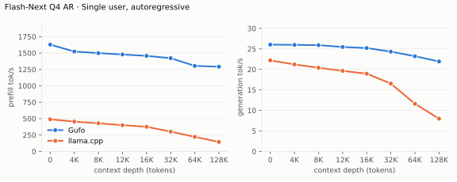
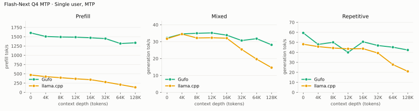
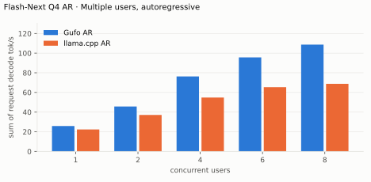
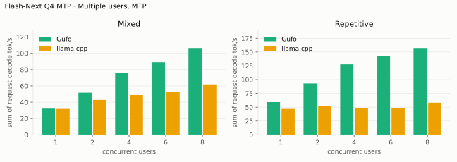
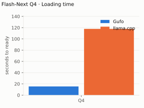
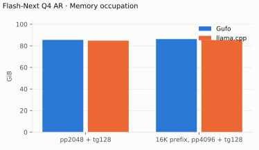

# Qwen3.8 Flash-Next benchmarks

AMD Strix Halo `gfx1151`, 128 GB unified memory. Unsloth `UD-Q4_K_XL` target and
shared-Q8_0 MTP sidecar; Gufo uses adaptive MTP. HTTP, greedy, thinking off.
Gufo single-user MTP, concurrency, loading and llama.cpp MTP at 64K/128K:
September 23, 2026; other results: September 22.
llama.cpp uses `b11069` for AR and `6fcaa16f` for MTP.

Positive gain favors Gufo.
[Quality and measurement details](QUALITY.md#benchmark-method) · [Model identities](artifacts/model-identities.json)

## Speed campaign stack (October 2026)

October 26, 2026, the integration branch (every campaign win merged), `UD-Q4_K_XL`,
`--kv-cache tq4`, GPU `auto`, one Strix Halo test host. Three arms:

- **base**: the pre-campaign tree.
- **default**: the integrated tree with no options. Every change on this path
  is bit-identical to base ([evidence](QUALITY.md#the-default-path-is-exact)).
- **stack**: the recommended opt-in stack,
  `--dense-prefill w4a4 --dense-prefill-weights DIR --gdn-state f16
  --gguf-decode-override q4k-gptq2-h5.gguf --prefill-capacity 8192
  --prefill-phase-rows 2048` ([quality](QUALITY.md#lossy-options-measured-quality)).

The retained raw files are in [artifacts/campaign](artifacts/campaign).

### Single user

`gufo bench`, sustained second pass (the 140 W burst lasts about 110 s). Base
and stack ran twice, interleaved; tok/s. `20261026T184037Z-w3a-bench`.

| | base (2 rounds) | default | stack (2 rounds) |
| --- | ---: | ---: | ---: |
| pp512 | 1247 / 1187 | 1184 | 1184 / 1192 |
| pp2048 | 1609 / 1596 | 1669 (+4%) | 1870 / 1867 (**+17%**) |
| pp8192 | 1532 / 1494 | 1546 (+2.5%) | 1868 / 1865 (**+24%**) |
| tg128 | 25.34 / 25.57 | 27.06 (+6.7%) | 34.7 / 34.8 (**+37%**) |
| pp2048 @ d32768 | 1428 / 1432 | 1474 (+3%) | 1625 (**+13.5%**) |
| tg128 @ d32768 | 24.52 / 24.73 | 26.29 (+6.3%) | 33.4 / 33.5 (**+36%**) |

pp512 is unchanged within the base's own spread (the int4 dense path starts at
2048 rows). A stack that also adds `--routed-w4 64` and `--prefill-residual f16`
(rejected on prefill-row quality) measured pp2048 2213 (+38%), pp8192 2083
(+38%), tg128 35.2 and d32K pp2048 1888 (+32%), one round.

### Concurrent decode, distinct prompts

Decode-only cohorts of distinct prompts (`decode-multi/cohort.py`: each request
its own text, 128 tokens, a C32 warm-up first; the metric is the summed
per-request decode rate, tok/s), after the prefetch-kernel fix. Base and stack
four cohort passes each in two interleaved rounds, default two passes.
`20261026T212717Z-w3b-cohorts`.

| Sessions | base | default | stack |
| --- | ---: | ---: | ---: |
| 2 | 42.1–42.7 | 44.2 (+4%) | 52.1–52.6 (+24%) |
| 4 | 65.1–66.4 | 66.6 (+2%) | 72.4–73.0 (+11%) |
| 8 | 91.6–92.9 | 94.5 (+2%) | 100.7–101.6 (+10%) |
| 32 | 179.0–180.3 | 182.7 (+2%) | 200.9–206.2 (+14%) |

Before the fix the default regressed C8 to 84.5 against base 96.8 tok/s (−11%):
the single-row prefetching GEMM kernel ran at up to eight rows. It is now used
at one or two rows only (bit-identical either way), and C8 is no longer below
base ([history](EXPERIMENTS.md#retained-exact-default-path)).

### Single user MTP, adaptive policy

C1, 256 generated tokens per workload, `tools/qwen-flash/specbench.py`
(prose, a repeated passage, code, a file edit, a tool-call loop, a long
context), 90 s of decode warm-up per server, base / default / stack servers
interleaved in two rounds; tok/s, mean of the rounds. "Base" is the base binary
with its default per-session MTP controller; "default" and "stack" run
`--mtp-policy adaptive --mtp-draft-vocab draft-vocab-ranked.txt
--mtp-draft-vocab-size 32768`. `20261026T230452Z-w3c-mtp` (stack after the
draft-head fix below).

| Workload | base MTP | default, adaptive | stack, adaptive |
| --- | ---: | ---: | ---: |
| prose | 34.5 | 35.8 (+4%) | 42.3 (+23%) |
| repeated passage | 89.5 | 108.9 (+22%) | 110.5 (+23%) |
| code | 44.3 | 59.4 (+34%) | 50.8 (+15%) |
| file edit | 70.8 | 91.8 (+30%) | 92.6 (+31%) |
| tool loop | 59.8 | 87.5 (+46%) | 84.5 (+41%) |
| long context | 28.4 | 38.9 (+37%) | 39.7 (+40%) |

Default against base over three windows (`20261026T210644Z-w3c-mtp`,
`20261026T230452Z-w3c-mtp`, `20261026T233643Z-w3i-twin8`): prose +4% to +7%,
repetition +16% to +22%, code +34% to +45%, edit +21% to +30%, tool +46% to
+64%, long +24% to +37%. The default includes the exact decode kernels (+6.7%
tg), so part of the gain is not the policy. Output hashes of the default equal
the base MTP run's in every workload and the default's own AR run's in prose
and code (`20261026T215542Z-w3f-mtpdiag`); 22/22 greedy requests match AR in
[QUALITY](QUALITY.md#the-default-path-is-exact).

On the stack, AR decodes 33.6–34.6 tok/s (`ar-best`), so MTP adds +23% on prose
and +47% on code over the stack's own AR; MTP output on the stack is not
bit-identical to its AR output or between runs: `--gdn-state f16` rounds the
recurrent state per verified chain instead of per token, and the draft widths
(timing-steered) change the chain boundaries (different output hashes between
two identical runs on prose, code and long). The text stays equivalent in quality
(the f16 state's own ladder is KL 0.007), but MTP is no longer lossless there.

A first stack measurement (`20261026T210644Z-w3c-mtp`) found MTP drafts almost
never accepted (prose 3/109, code 11/128; 27 and 28 tok/s, below the stack's
own AR). Only the decode twins did it (`20261026T215542Z-w3f-mtpdiag`: macro,
int4 dense and F16 state alone kept 40–50% acceptance); sweeping
`--decode-twin-rows` showed the draft rounds themselves were affected
(`20261026T222853Z-w3g-twinmtp`: acceptance 3/119 at rows 1, 3/119 at rows 2,
2/135 at rows 8 and 125/295 at rows 0, i.e. twins off). Cause: the compact
draft head (`--mtp-draft-vocab`) copied the full
head's tensor descriptor, including its pointer to the Q5_K decode-twin head
indexed by token id, so one-row draft rounds scored token ids 0–32767 instead of
the ranked draft vocabulary. Fixed in `Executor::LoadDraftVocabulary`
(`draft_head_.alt = nullptr`); the table above is after the fix.

### Agent serving on the stack

`tools/qwen-flash/qa/agent_sim.py` at the standard-load shape (40 agents, one
~20K-token system prompt, 30–100K contexts, ~6 s tool time, seed 1), shortened
to 10 minutes of arrivals; production flags (24 sessions, 131072 context, tq4,
8 GiB host budget, 2 flex sessions, a fresh disk prefix cache per run, no
MTP); rates rebuilt from the server log with `throughput.py`. Single runs,
two orders (base first, then stack first) for the headline pair. Per-run files
in [artifacts/campaign/w5-agents](artifacts/campaign/w5-agents).

| Arm | Turns | Decode avg / ITL p50 | Prefill avg, uncached (tok/s) | TTFT p50 / p90 (s) | First-turn TTFT p50 / p90 (s) |
| --- | ---: | ---: | ---: | ---: | ---: |
| base (run 1 / run 2) | 206 / 212 | 36.4 / 36.0 tok/s, 191 / 190 ms | 566 / 569 | 6.3 / 39.0, 7.2 / 39.3 | 8.1 / 36.6, 9.2 / 39.3 |
| default (exact) | 214 | 39.4 tok/s, 192 ms | 539 | 8.7 / 49.2 | 18.0 / 34.6 |
| stack minus macro (`--dense-prefill`, `--gdn-state f16`, twins) | 232 | 38.5 tok/s, 174 ms | 567 | 7.2 / 37.0 | 8.6 / 35.1 |
| stack (run 1 / run 2) | 219 / 198 | 39.1 / 38.0 tok/s, 175 / 169 ms | 557 / 566 | 7.1 / 39.4, 8.5 / 40.8 | 13.4 / 33.2, 19.3 / 34.2 |

What is and is not visible here:

- **Decode** is consistently faster: +6% to +8% average rate for the stack and
  the default, ITL p50 190 → 169–175 ms, 60 s decode peak 55–60 → 59–73 tok/s.
- **Prefill and turns show no measurable difference.** Uncached prefill averages
  539–569 tok/s in every arm, and turns completed are 198–232 with the base's own
  two runs at 206 and 212. The stack's +17–24% pp2048/pp8192 are single-session
  steps of ≥ 2048 rows; this load is ~95% prefix-cache hits and its prompt work
  runs in fused steps beside decoders [INFERENCE: those chunks stay under the
  2048-row int4 threshold], so the load is not prefill-bound at this size.
- **First-turn TTFT p50** (new agents with a long uncached prompt) ranged
  8.1–19.3 s across the five stack/default runs and 8.1 / 9.2 s for base, with
  no pattern tied to a flag: the default (no options) and the stack with the
  macro batch were slow, the stack without it was not. p90 is 33–41 s in every
  arm. With one run per arm and random arrivals this metric is noise at this
  sample size; a regression would need more runs to show.

### Adapters beside the base model

Production-like server on a test port (24 sessions, 131072 context, tq4, 8 GiB
host budget, flex sessions, disk cache; the stack's flags) with
`--adapter huihui=… --adapter orca=…`, one process, three model ids
(`20261026T205744Z-w4-adapters`, `20261026T212534Z-w4d-cache`).

| Check | Result |
| --- | --- |
| Base requests with adapters loaded vs the same server without them | 16/16 greedy generations identical, 930/930 teacher-forced positions bit-identical |
| Refusal smoke (8 refusal-prone, 8 benign prompts) | base refuses 4/8, huihui 0/8, Orca 0/8; no benign refusals |
| Co-batched ids (round-robin base/huihui/Orca rows in one step), teacher-forced against each id's solo run | C6: KL 0.020 / 0.022 / 0.018; C24: 0.016 / 0.024 / 0.018 (base / huihui / Orca), top-1 93–96%. Adapters are no noisier than base. |
| Cache isolation (fresh prompt seed per id pair, RAM + disk) | PASS for base↔Orca, huihui↔Orca, base↔huihui, Orca↔huihui: the other id's first request misses (0 cached tokens), the repeat hits (1746–1769) |
| Overhead, single request, pp≈480 / tg128, 3 rounds, medians | decode 34.29 base, 33.45 huihui (−2.4%), 33.57 Orca (−2.1%); prefill 1167, 1162 (−0.4%), 1187 (spread 1168–1191, base 1163–1175) |

The C6/C24 KL is not a bit-exactness test: with the decode twins, a batch of more
than four rows reads the Q8_0 weights and a lone request the twins, so batched
and solo arithmetic legitimately differ on the stack. Bit-identical co-batching
of adapter and base rows is covered by the exact-default `session_test`
(mixed base/adapter batches equal standalone runs bit for bit).

## Agent serving

September 27, 2026, this branch. Simulated coding agents
(`tools/qwen-flash/qa/agent_sim.py`) arrive at random and share long system
prompts; each runs multi-turn tool loops (log-normal tool-output appends, then a
64–600-token reply, greedy, thinking off). Rates are per wall-clock second,
reconstructed from per-request server logs with `tools/qwen-flash/qa/throughput.py`;
prefill counts newly processed (uncached) tokens only. GPU performance level
`auto` (firmware throttling; sustained clock about 2475 MHz). "Production" is
`main` with 2 × 131072 MTP sessions.

**Standard load**: 40 agents, one ~20K-token system prompt, 30–100K contexts,
~6 s tool time, per-turn prefix hit ≈95%, 15 minutes of arrivals.

| | Production | 24 slots, tq4 | + shared-prefix store |
| --- | ---: | ---: | ---: |
| TTFT p50 / p90 / p99 (s) | 135 / 197 / 205 | 33 / 56 / 332 | **6.9 / 48 / 69** |
| New agent first-turn TTFT p50 (s) | – | – | **5.5** |
| Turns completed | 202 | 214 | **341** |
| Prompt tokens served from cache | 4.4M | 4.6M | **9.7M** |
| Decode avg / 60 s peak / 10 s peak (tok/s) | 24 / 35 / 46 | 31 / 64 / 80 | 33 / 47 / 55 |
| Prefill avg / 60 s peak / 10 s peak (tok/s) | 318 / 988 / 1417 | 650 / 1702 / 2851 | 592 / 802 / 1841 |

With the prefix store most prompt work becomes a cache restore, so fewer tokens
need prefill. After a server restart, 16 new agents restored the pinned system
prompt from disk: first-turn TTFT 4.7 s, no misses.

**Stress load**: 96 agents, four agent types with different ~20K system prompts,
40–120K contexts, ~20 s tool time, larger tool outputs (per-turn hit ≈87%). Both
configurations are saturated.

| | Production | 24 slots, tq4, `--max-itl-ms 750` | 24 slots, tq4, `--max-itl-ms 1500` (default) |
| --- | ---: | ---: | ---: |
| TTFT p50 / p90 / p99 (s) | 421 / 663 / 679 | 290 / 340 / 583 | **176 / 296 / 322** |
| First-turn TTFT p50 (s) | 296 | 287 | **131** |
| Turns completed | 200 (1613 s) | 190 (1362 s) | **251 (1257 s)** |
| Decode avg / 60 s peak (tok/s) | 23 / 38 | 26 / 49 | **34 / 61** |
| Prefill avg / 60 s peak / 10 s peak (tok/s) | 378 / 1238 / 1423 | 711 / 1678 / 2591 | 685 / **1934 / 3117** |
| Inter-token latency p50 / p99 (ms) | – / 668 | 695 / 1002 | 196 / 1655 |

MTP added nothing for this workload (standard load: TTFT p50 37 s, decode 27 tok/s
versus 33 s / 31 tok/s without). UD-IQ4_XS gave slightly higher decode peaks
(71 / 86 tok/s) at its measured quality cost.

## Single user, this branch

Same Q4_K_XL model, interleaved runs repeated twice (`gufo bench`, pp/tg in tok/s).

| | main | this branch | UD-IQ4_XS |
| --- | ---: | ---: | ---: |
| pp512 | 1060 | **1229** (+16%) | 1262 |
| pp2048 | 1670 | 1717 (+3%) | 1690 |
| tg128 | 26.65 | 26.23 (−1.6%) | 26.44 |
| pp512 @ d32768 | 967 | **1120** (+16%) | 1114 |
| pp2048 @ d32768 | 1496 | 1519 (+1.5%) | 1494 |
| tg128 @ d32768 | 24.23 | **25.16** (+4%) | 25.40 |

## Concurrent decode, this branch

Decode-only cohorts (QA `decode` suite, prose, depth 0, AR, tq4 KV), summed
request decode rates; no prompt processing competes.

| Sessions | 8 | 16 | 32 | 64 |
| --- | ---: | ---: | ---: | ---: |
| tok/s | 148 | 219 | 275 | 336 |

32 × 131072-token sessions load with tq4 and the lazy KV pool (15.8 GB pool,
17 full contexts) and decode at 245 tok/s at 32K depth. `main` caps batching at
8 sessions and deploys 2 × 131072.

The sections below were measured on `main` (September 22–23, 2026).

## Single user, autoregressive

Approximately pp2048 / tg128; depth is the cached prefix in tokens.
Context capacities differ between engines; see the measurement details.

<!-- bench:single-ar -->
| Flash-Next Q4 AR Depth (tokens) | Gufo pp (tok/s) | llama.cpp pp (tok/s) | Gain | Gufo tg (tok/s) | llama.cpp tg (tok/s) | Gain |
| ---: | ---: | ---: | ---: | ---: | ---: | ---: |
| 0 | 1628.52 | 489.59 | +232.6% | 26.04 | 22.20 | +17.3% |
| 4,096 | 1523.39 | 455.24 | +234.6% | 25.98 | 21.21 | +22.5% |
| 8,192 | 1499.13 | 428.85 | +249.6% | 25.91 | 20.40 | +27.0% |
| 12,288 | 1477.98 | 400.21 | +269.3% | 25.46 | 19.64 | +29.6% |
| 16,384 | 1457.16 | 375.89 | +287.7% | 25.20 | 18.95 | +33.0% |
| 32,768 | 1421.93 | 301.31 | +371.9% | 24.33 | 16.54 | +47.1% |
| 65,536 | 1304.01 | 221.94 | +487.6% | 23.21 | 11.62 | +99.7% |
| 131,072 | 1292.02 | 144.78 | +792.4% | 21.93 | 7.98 | +174.8% |
<!-- /bench -->

## Single user, MTP

pp is the highest measured rate per engine and depth across mixed/repetitive
text, including Gufo predictor catch-up.

<!-- bench:single-mtp -->
| Flash-Next Q4 MTP Depth (tokens) | Gufo pp (tok/s) | llama.cpp pp (tok/s) | Gain pp | Gufo tg mixed (tok/s) | llama.cpp tg mixed (tok/s) | Gain mixed | Gufo tg repetitive (tok/s) | llama.cpp tg repetitive (tok/s) | Gain repetitive |
| ---: | ---: | ---: | ---: | ---: | ---: | ---: | ---: | ---: | ---: |
| 0 | 1602.82 | 468.76 | +241.9% | 32.18 | 31.73 | +1.4% | 59.41 | 48.12 | +23.5% |
| 4,096 | 1506.32 | 423.79 | +255.4% | 34.57 | 34.48 | +0.3% | 47.92 | 45.71 | +4.8% |
| 8,192 | 1492.95 | 394.98 | +278.0% | 34.97 | 32.20 | +8.6% | 50.02 | 44.31 | +12.9% |
| 12,288 | 1488.03 | 365.91 | +306.7% | 35.18 | 32.32 | +8.8% | 39.95 | 43.53 | -8.2% |
| 16,384 | 1471.81 | 341.98 | +330.4% | 33.84 | 32.07 | +5.5% | 50.55 | 43.66 | +15.8% |
| 32,768 | 1449.56 | 277.61 | +422.2% | 30.67 | 25.41 | +20.7% | 46.81 | 39.28 | +19.2% |
| 65,536 | 1316.70 | 208.04 | +532.9% | 31.78 | 19.65 | +61.7% | 45.12 | 27.75 | +62.6% |
| 131,072 | 1335.91 | 135.42 | +886.5% | 28.12 | 14.63 | +92.2% | 42.32 | 20.96 | +101.9% |
<!-- /bench -->

## Multiple users, autoregressive

Same pp2048 prose prompt as single-user d0, tg128, context 4096 per user.
All sessions prefilled before timed decoding; throughput sums individual rates.
llama.cpp re-evaluates its four-token checkpoint tail.

<!-- bench:multi-ar -->
| Flash-Next Q4 AR Users | Gufo AR (tok/s) | llama.cpp AR (tok/s) | Gain |
| ---: | ---: | ---: | ---: |
| 1 | 25.85 | 22.34 | +15.7% |
| 2 | 45.70 | 37.08 | +23.2% |
| 4 | 76.29 | 54.82 | +39.2% |
| 6 | 95.66 | 65.34 | +46.4% |
| 8 | 108.67 | 68.79 | +58.0% |
<!-- /bench -->

## Multiple users, MTP

Same pp2048 mixed/repetitive prompts as single-user d0, tg128, context 4096
per user. All sessions prefilled before timed decoding; rates sum individual
request decode rates. C1 cross-checks the single-user table.

<!-- bench:multi-mtp -->
| Flash-Next Q4 MTP Users | Gufo mixed (tok/s) | llama.cpp mixed (tok/s) | Gain | Gufo repetitive (tok/s) | llama.cpp repetitive (tok/s) | Gain |
| ---: | ---: | ---: | ---: | ---: | ---: | ---: |
| 1 | 32.09 | 31.77 | +1.0% | 59.20 | 46.93 | +26.1% |
| 2 | 51.68 | 42.79 | +20.8% | 93.16 | 52.57 | +77.2% |
| 4 | 75.92 | 48.78 | +55.6% | 127.91 | 48.23 | +165.2% |
| 6 | 89.18 | 52.59 | +69.6% | 142.14 | 48.51 | +193.0% |
| 8 | 106.47 | 61.92 | +71.9% | 157.22 | 58.13 | +170.5% |
<!-- /bench -->

## Loading time

C1, context capacity 262144, MTP. Cold target/sidecar files to HTTP readiness.

<!-- bench:loading -->
| Flash-Next Q4 Target | Gufo ready (s) | llama.cpp ready (s) | Gain |
| --- | ---: | ---: | ---: |
| Q4 | 15.45 | 117.83 | +662.7% |
<!-- /bench -->

## Memory occupation

C1, context capacity 133121, AR. Peak memory reported by HIP.

<!-- bench:memory -->
| Flash-Next Q4 AR Workload | Gufo GiB | llama.cpp GiB | Gain |
| --- | ---: | ---: | ---: |
| pp2048 + tg128 | 85.55 | 84.84 | -0.8% |
| 16K prefix, pp4096 + tg128 | 86.27 | 85.31 | -1.1% |
<!-- /bench -->

